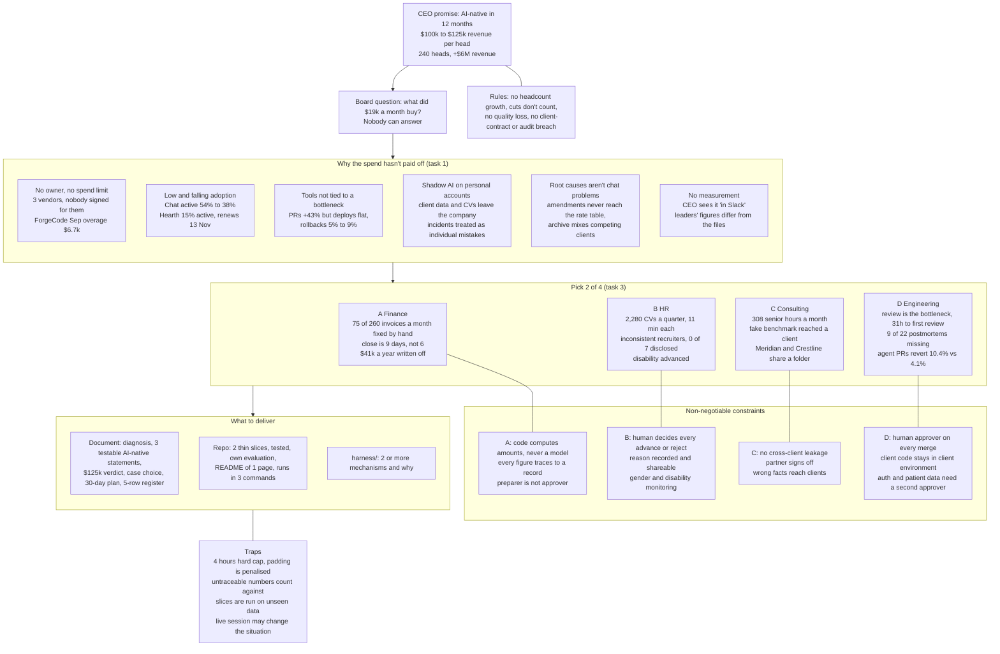

# Problem map (working file, not the submission)

Figures come from `evidence_notes.md`; paths are relative to `dossier/`.

## Problem statement and key challenges

## Notes on the map
- The leaders' figures mostly hold up (260 invoices, 14 proposals, 22 hours, $420k, 24% win rate). The gaps are in how they are framed: the books close finally on day 9, not 6; the 40% rise in PRs came with flat deployments and a higher rollback rate; both incidents were closed with no control added; and "35% rebuilt" comes from a survey of 18 people.
- Hearth renews on 13 Nov 2026 unless notice arrives at least 14 days earlier, which is 30 Oct. The dossier is dated 1 Oct 2026, so there is still time to serve notice or cut seats. `vendor_invoices/hearth_workspace_2026-09.txt`
